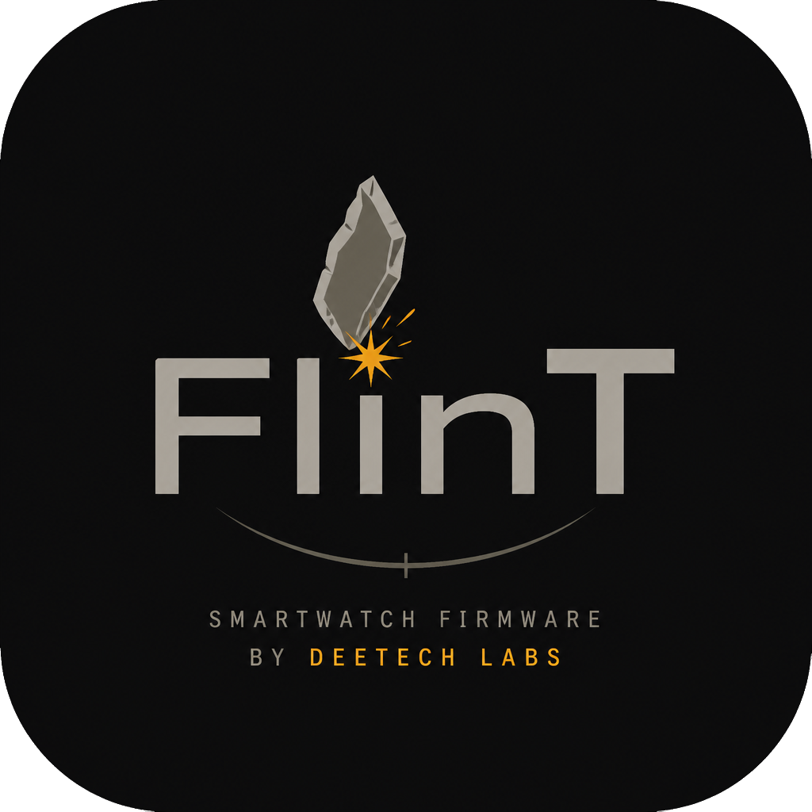

<p align="center">
  
</p>

<h1 align="center">FlinT Desktop</h1>

<p align="center">
  <b>Desktop companion</b> for <b>FlinT</b> devices · Spark and future models · Qt6 / QML<br/>
  by <a href="https://github.com/DeeTech-Labs">DeeTech Labs</a>
</p>

<p align="center">
  <a href="https://github.com/DeeTech-Labs/FlinT-Desktop/stargazers"></a>
  
  
  <a href="LICENSE"></a>
</p>

<p align="center">
  <a href="#quick-start">Quick start</a> ·
  <a href="#docs">Docs</a> ·
  <a href="https://github.com/DeeTech-Labs/FlinT-OS">FlinT OS</a> ·
  <a href="https://github.com/DeeTech-Labs/FlinT-Desktop/discussions">Discussions</a>
</p>

---

## What it is

**FlinT Desktop** is the companion application for **FlinT** devices running
[FlinT OS](https://github.com/DeeTech-Labs/FlinT-OS), by **DeeTech Labs**.
The first supported device is **FlinT Spark**. Device identity and advertised
capabilities drive the connection, so the client can support future models.

<table>
  <tr>
    <td width="50%" valign="top">
      <h3>Built-in</h3>
      <ul>
        <li>USB device discovery and connection</li>
        <li>Device identity, settings and runtime status</li>
        <li>PC time synchronization</li>
        <li>Session capture · JSON export · USB log</li>
      </ul>
    </td>
    <td width="50%" valign="top">
      <h3>Stack</h3>
      <ul>
        <li>C++17 · Qt 6.5+</li>
        <li>Qt Quick / QML · Quick Controls · Quick Dialogs</li>
        <li>Qt Serial Port · asynchronous USB I/O</li>
        <li>CMake · Linux / Windows / macOS targets</li>
      </ul>
    </td>
  </tr>
</table>

Settings editing, face management and firmware updates are planned; the current
application reads device state and synchronizes time. Linux builds and the USB
client are covered by CI; Windows/macOS are target platforms, not validated packages.

---

## Quick start

**Requirements:** Qt 6.5+ with Quick, Quick Controls, Quick Dialogs and Serial Port;
CMake 3.21+; a C++17 compiler. Python 3 is needed only for integration tests.

```bash
cmake -S . -B build -DCMAKE_BUILD_TYPE=Debug
cmake --build build --parallel
./build/flint_desktop
```

For a non-system Qt installation, pass `-DCMAKE_PREFIX_PATH=/path/to/Qt/6.x/gcc_64`.
In Qt Creator, open `CMakeLists.txt` and select a Qt6 kit. Platform-specific notes:
[docs/BUILD.md](docs/BUILD.md).

<details>
<summary><b>Connect a device</b></summary>

1. Connect Spark over USB. Firmware must support `HELLO`, `INFO` and `STATUS`.
2. Close any serial monitor or `sync_time.py --watch` using the same port.
3. Refresh the port list, select the device and connect.
4. The app polls status every two seconds. Use the time-sync button to set UTC
   from the PC, or save the session with the JSON export button.

The in-memory session retains the newest 600 snapshots (about 20 minutes at the
normal polling rate). Disconnecting preserves the last data for export; a new
connection clears the session. Files are written only when requested. No startup
service or background network upload is installed.

</details>

<details>
<summary><b>Command-line capture</b></summary>

```bash
./build/flint_desktop --probe /dev/ttyACM0
./build/flint_desktop --probe /dev/ttyACM0 --sync-time --output capture.json
./build/flint_desktop --probe /dev/ttyACM0 --samples 10 --output series.json
```

`--samples` accepts 1–600 snapshots. Time sync retains the states before and after
sync, even when one sample is requested. JSON goes to stdout; exit code 0 means
success, 2 means an exchange/export error. On a headless Linux host, set
`QT_QPA_PLATFORM=offscreen` before launching the command.

</details>

<details>
<summary><b>Project layout</b></summary>

```text
flint_desktop/
├── src/                 # C++ entry point and services
│   └── device/          # USB protocol, session, polling and export
├── qml/                 # Qt Quick interface
├── tests/               # Real Qt client + serial emulator
├── docs/                # Build, architecture and USB protocol
├── brand/               # Shared FlinT logo
└── .github/             # CI, issue forms and code owners
```

</details>

---

## Docs

- [Build and run](docs/BUILD.md) — Qt kits, platform paths and checks.
- [Architecture](docs/ARCHITECTURE.md) — UI, USB session and device capabilities.
- [USB protocol and capture format](docs/USB-DATA.md) — commands, fields and JSON files.
- [Changelog](CHANGELOG.md) — development history.
- [FlinT OS](https://github.com/DeeTech-Labs/FlinT-OS) — device firmware.

---

## Contributing

[CONTRIBUTING.md](CONTRIBUTING.md) · [SUPPORT.md](SUPPORT.md) ·
[SECURITY.md](SECURITY.md) · [CODE_OF_CONDUCT.md](CODE_OF_CONDUCT.md) ·
[Discussions](https://github.com/DeeTech-Labs/FlinT-Desktop/discussions)

---

## License

Copyright 2026 DeeTech Labs · [Apache License 2.0](LICENSE) ·
keep attribution in [NOTICE](NOTICE).

---

## Contributors

Thanks to everyone who has contributed to FlinT Desktop:

<p align="center">
  <a href="https://github.com/DeeTech-Labs/FlinT-Desktop/graphs/contributors">
    
  </a>
</p>

<p align="center">
  <sub>FlinT Desktop · DeeTech Labs · Apache 2.0 · Qt6</sub>
</p>
