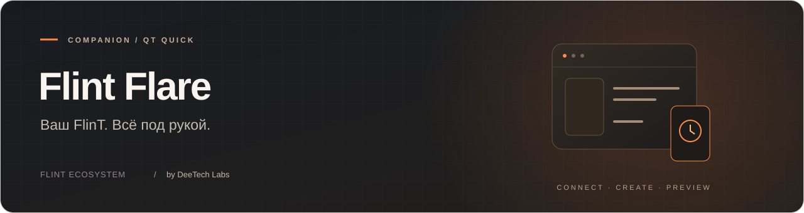

<p align="center">
  
</p>

<p align="center">
  <a href="LICENSE"></a>
  
  
</p>

<p align="center">
  <a href="#быстрый-старт">Быстрый старт</a> &nbsp; · &nbsp; <a href="#документация">Документация</a> &nbsp; · &nbsp; <a href="#лицензия">Лицензия</a> &nbsp; · &nbsp; <a href="#участники">Участники</a>
</p>

<p align="center">
  <a href="docs/en/README.md">English version</a> &nbsp; / &nbsp;
  <a href="https://flint.deetech.ru/">Сайт экосистемы</a> &nbsp; / &nbsp;
  <a href="https://github.com/DeeTech-Labs">DeeTech Labs</a>
</p>

---

Приложение-компаньон устройств **FlinT** с [FlinT OS](https://github.com/DeeTech-Labs/FlinT-OS), разработка **DeeTech Labs**. Первое поддерживаемое устройство — **FlinT Spark**.

## Возможности

- **Подключение.** Обнаружение устройств по USB и Bluetooth LE, информация об устройстве и синхронизация времени.
- **Ignite Hub.** Установка пакетов, запуск компонентов, выбор часов, темы и языка; управление разрешениями.
- **Studio и Preview.** Компиляция локальных проектов и просмотр через общий Runtime.
- **Автономный симулятор.** Разработка и проверка без физического устройства.

## Быстрый старт

Нужны Qt 6.5+ с Quick, Quick Controls, Quick Dialogs, Serial Port, Bluetooth, Widgets и Shader Tools; CMake 3.21+, компилятор C++20, Python 3 и Pillow для компилятора ресурсов и интеграционных тестов. Команды из корня репозитория:

```sh
git submodule update --init --recursive
cmake -S . -B build -DCMAKE_BUILD_TYPE=Debug
cmake --build build --parallel
./build/flint_flare
ctest --test-dir build --output-on-failure
```

Для несистемной Qt передайте `-DCMAKE_PREFIX_PATH=/path/to/Qt/6.x/gcc_64`. Тест запускает настоящее приложение QML с временным автономным симулятором, без поиска или подключения USB/BLE-устройств. Подробности: [сборка](docs/ru/BUILD.md).

## Подключение устройства

1. В разделе подключения выберите USB или Bluetooth LE; автоматического подключения нет.
2. Для новой BLE-привязки сначала подключите USB, откройте окно сопряжения и подтвердите совпадающий код через сохранённый USB-канал.
3. После проверки совместимости используйте синхронизацию времени и Ignite Hub. Без устройства доступен локальный симулятор.

Передача CPU/RAM требует одновременно разрешения активного Ignite с точной областью и локальной политики Flare. Настройки остаются локальными; служба автозапуска и фоновая загрузка данных в сеть не устанавливаются.

## Текущий статус

Локально проверена сборка Linux; Windows и macOS проверяются в CI. Обновление прошивки, фоновые службы и дополнительные интеграции компьютера пока не реализованы.

## Устройство проекта

`src/platform_app/` — PlatformClient, IgniteHub, Studio, Preview и CompanionService; `src/device/` — жизненный цикл Bluetooth/BlueZ; `qml/` — дизайн-система Qt Quick и экраны; `assets/` — иконки и шрифты; `shaders/` — эффекты; `translations/` — языковые каталоги; `brand/` — общий логотип; `.github/` — CI и шаблоны.

`platform/` — [Flint IgniteSDK](https://github.com/DeeTech-Labs/Flint-IgniteSDK) на закреплённом коммите. SDK содержит общие Core, Runtime, компилятор и контракты; копий исходников нет. Изменения в общей реализации вносятся в SDK, затем обновляется ссылка подмодуля.

## Документация

- [Архитектура](docs/ru/ARCHITECTURE.md).
- [Протокол USB/BLE Companion](docs/ru/COMPANION-PROTOCOL.md).
- [Локализация интерфейса](docs/ru/LOCALIZATION.md).
- [Общая платформа](platform/README.md).
- [История изменений](CHANGELOG.md).
- [Вклад в проект](CONTRIBUTING.md), [поддержка](SUPPORT.md), [безопасность](SECURITY.md), [правила сообщества](CODE_OF_CONDUCT.md).

[Обсуждения](https://github.com/DeeTech-Labs/Flint-Flare/discussions) · [сайт](https://flint.deetech.ru/).

---

## Лицензия

[PolyForm Noncommercial 1.0.0](LICENSE). Для разработки бесплатных и платных независимых Ignite действует [отдельное разрешение](docs/ru/SDK-DEVELOPMENT-PERMISSION.md), включая необходимые средства Studio и Preview.

[Все условия лицензирования](docs/ru/LICENSING.md) · [Уведомления о компонентах](NOTICE).

## Участники

Спасибо всем, кто помогает развивать **Flint Flare**: пишет код, проверяет сборки, находит ошибки, улучшает документацию и переводы.

<a href="https://github.com/DeeTech-Labs/Flint-Flare/graphs/contributors">
  
</a>

<p><sub>Flint Flare · Часть экосистемы FlinT · Разработка DeeTech Labs</sub></p>
