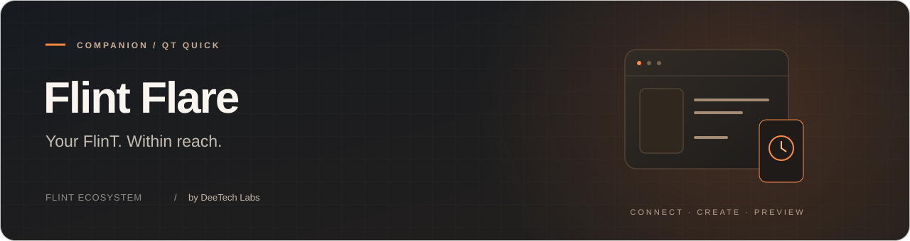

<p align="center">
  
</p>

<p align="center">
  <a href="../../LICENSE"></a>
  
  
</p>

<p align="center">
  <a href="#quick-start">Quick start</a> &nbsp; · &nbsp; <a href="#documentation">Documentation</a> &nbsp; · &nbsp; <a href="#license">License</a> &nbsp; · &nbsp; <a href="#contributors">Contributors</a>
</p>

<p align="center">
  <a href="../../readme">Русская версия</a> &nbsp; / &nbsp;
  <a href="https://flint.deetech.ru/">Website</a> &nbsp; / &nbsp;
  <a href="https://github.com/DeeTech-Labs">DeeTech Labs</a>
</p>

---

## What it is

**Flint Flare** is the companion application for **FlinT** devices running
[FlinT OS](https://github.com/DeeTech-Labs/FlinT-OS), by **DeeTech Labs**.
The first supported device is **FlinT Spark**. Device identity and advertised
capabilities drive the connection, so the client can support future models.

<table>
  <tr>
    <td width="50%" valign="top">
      <h3>Built-in</h3>
      <ul>
        <li>USB and Bluetooth LE device discovery and connection</li>
        <li>Device identity, component settings and runtime status</li>
        <li>PC time synchronization</li>
        <li>Ignite Hub · Studio · shared Runtime preview · per-app consent</li>
      </ul>
    </td>
    <td width="50%" valign="top">
      <h3>Stack</h3>
      <ul>
        <li>C++20 · Qt 6.5+</li>
        <li>Qt Quick / QML · Quick Controls · Quick Dialogs</li>
        <li>Qt Serial Port + Qt Bluetooth · asynchronous I/O</li>
        <li>CMake · Linux / Windows / macOS targets</li>
      </ul>
    </td>
  </tr>
</table>

Ignite Hub installs binary packages with resumable transfer, launches components, selects clock/theme/language providers, and manages application permissions. Studio compiles local projects; Preview and the disposable simulator use the same portable runtime as FlinT OS.

The existing QML shell, theme, icons, fonts, effects, localization and tray integration are retained. Bounded Lua runs in the simulator and validated Spark firmware. Firmware updates, background services and additional host integrations remain future work; see the [shared implementation specification](../../platform/readme). Linux builds are verified locally; Windows/macOS remain CI targets rather than locally validated packages.

---

## Quick start

**Requirements:** Qt 6.5+ with Quick, Quick Controls, Quick Dialogs, Serial Port, Bluetooth, Widgets and Shader Tools;
CMake 3.21+; a C++20 compiler. Python 3 and Pillow support the project compiler and integration tests.

```bash
cmake -S . -B build -DCMAKE_BUILD_TYPE=Debug
cmake --build build --parallel
./build/flint_flare
```

For a non-system Qt installation, pass `-DCMAKE_PREFIX_PATH=/path/to/Qt/6.x/gcc_64`.
In Qt Creator, open `CMakeLists.txt` and select a Qt6 kit. Platform-specific notes:
[docs/BUILD.md](BUILD.md).

<details>
<summary><b>Connect a device</b></summary>

1. Open Connection and select USB or Bluetooth LE. No device connection is started automatically.
2. For a new BLE bond, connect USB first, open the pairing window, then connect BLE. Compare and confirm the code on both sides through the retained local USB channel.
3. Flare checks the protocol, development contract revision, build identity and required capabilities before allowing application operations.
4. Use the time-sync button or Ignite Hub to manage the connected device. A local simulator is available without hardware.

CPU/RAM sharing requires both the active Ignite's scoped permission and Flare's independent local policy. Preferences stay local; no startup service or background network upload is installed.

</details>

<details>
<summary><b>Offline verification</b></summary>

```bash
ctest --test-dir build --output-on-failure
QT_QPA_PLATFORM=offscreen QT_QUICK_BACKEND=software ./build/flint_flare --smoke
```

The smoke test loads the actual QML application and a disposable local simulator. It does not scan for or connect to USB/BLE devices.

</details>

<details>
<summary><b>Project layout</b></summary>

```text
flint_flare/
├── src/                 # C++ entry point and application services
│   ├── platform_app/    # device manager, Hub, Studio, Preview and Companion
│   └── device/          # reusable Bluetooth / BlueZ hardware lifecycle
├── platform/            # Flint IgniteSDK Git submodule (pinned commit)
├── qml/                 # retained Qt Quick design system and adapted screens
├── assets/              # icons and fonts
├── shaders/             # visual effects
├── translations/        # interface language catalogs
├── docs/                # build, architecture and Companion contract
├── brand/               # shared FlinT logo
└── .github/             # CI, issue forms and code owners
```

</details>

---

## Documentation

- [USB/BLE companion protocol](COMPANION-PROTOCOL.md) — binary v1 framing, compatibility checks and pairing trust.

- [Build and run](BUILD.md) — Qt kits, platform paths and checks.
- [Architecture](ARCHITECTURE.md) — UI, USB session and device capabilities.
- [Shared platform](../../platform/readme) — package format, runtime, permissions and explicit limits.
- [Changelog](../../CHANGELOG.md) — development history.
- [FlinT OS](https://github.com/DeeTech-Labs/FlinT-OS) — device firmware.

---

## Contributing

[CONTRIBUTING.md](CONTRIBUTING.md) · [SUPPORT.md](SUPPORT.md) ·
[SECURITY.md](SECURITY.md) · [CODE_OF_CONDUCT.md](CODE_OF_CONDUCT.md) ·
[Discussions](https://github.com/DeeTech-Labs/Flint-Flare/discussions)

---

## License

Copyright 2026 DeeTech Labs · [PolyForm Noncommercial 1.0.0](../../LICENSE) ·
keep attribution in [NOTICE](../../NOTICE).

---


## Contributors

Thank you to everyone who contributes code, tests, bug reports, documentation and translations to **Flint Flare**.

<a href="https://github.com/DeeTech-Labs/Flint-Flare/graphs/contributors">
  
</a>

<p><sub>Flint Flare · Part of the FlinT ecosystem · Developed by DeeTech Labs</sub></p>
