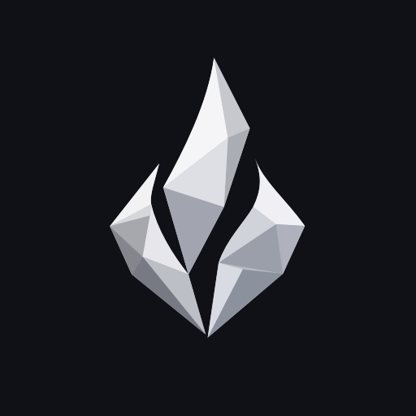

# Логотип Flint Flare

[English version](../en/BRANDING.md)

## Мастер

[brand/flare-logo.svg](../../brand/flare-logo.svg) — канонический векторный мастер на прозрачном фоне. Контуры и серебристые грани восстановлены по растровому концепту как редактируемые векторные пути. PNG не встроен в SVG и не используется при экспорте.

Мастер использует `viewBox="0 0 1254 1254"`, обычные пути и заливки. В нём нет внешних ресурсов, шрифтов, скриптов, фильтров или масок. Его можно редактировать в Inkscape, Illustrator или другом SVG-редакторе. Сохраняйте ID групп, если они используются вашей анимацией.

## Слои и грани

Общая группа имеет ID `flare-mark`. В ней три самостоятельные группы: `flare-left`, `flare-core`, `flare-right`. В каждой — базовый силуэт и отдельные грани с ID `left-facet-01`…`07`, `core-facet-01`…`05`, `right-facet-01`…`06`.

При встраивании SVG в DOM или импорте в редактор анимации можно управлять каждой группой или гранью. Для вращений и масштабирования задавайте точку преобразования явно. Центральная нижняя опорная точка знака — примерно `(627, 1018)` в координатах мастера.

Файлы [левого](../../brand/flare-layer-left.svg), [центрального](../../brand/flare-layer-core.svg) и [правого](../../brand/flare-layer-right.svg) слоёв имеют одинаковый размер и `viewBox`; они точно совмещаются при наложении. Это производные мастера, а не отдельные оригиналы для редактирования.

## Анимация

Группы и отдельные грани мастера можно анимировать в среде, которая поддерживает доступ к элементам SVG. Для Qt Quick используйте отдельные SVG-слои: обычный `Image` показывает SVG целиком и не предоставляет доступ к его внутренним ID. Размещайте слои в одинаковых границах и управляйте их преобразованиями средствами приложения.

Каталог `brand/` содержит только изображения и иконки. Реализация и демонстрационная сцена Qt в него не входят.

## Иконки платформ

- **Linux:** прозрачный [мастер SVG](../../brand/flare-logo.svg), либо PNG нужного размера. Для контрастной подложки доступен [flare-app-icon.svg](../../brand/flare-app-icon.svg).
- **Windows:** [flint-flare.ico](../../brand/icons/flint-flare.ico), содержащий размеры 16, 24, 32, 48, 64, 128 и 256 пикселей.
- **macOS:** [flint-flare.icns](../../brand/icons/flint-flare.icns), включающий представление 1024 пикселя.
- **Другие применения:** PNG с прозрачностью `brand/icons/flare-{size}.png` и с графитовой подложкой `brand/icons/flare-app-{size}.png`. Размеры: 16, 24, 32, 48, 64, 128, 256, 512, 1024.

Это подготовленные ресурсы. Иконки исполняемого файла, bundle и пакетных форматов пока не переключены: подключение выполняется в соответствующей конфигурации сборки/упаковки. Внешние размеры и отступы можно адаптировать под требования платформы, не меняя мастер.

## Правки и экспорт

Исходник нового логотипа — `brand/flare-logo.svg`. Вариант с подложкой, отдельные слои и растровые иконки являются производными: после изменения мастера обновляйте их вместе. Сохраняйте одинаковый `viewBox` у всех слоёв и проверяйте результат при малых размерах.

SVG можно экспортировать в PNG в векторном редакторе; для ICO и ICNS нужны соответствующие многомасштабные контейнеры. Готовые платформенные файлы находятся в `brand/icons/`.

[Политика бренда](TRADEMARKS.md) · [Иконки интерфейса](ICONS.md)
